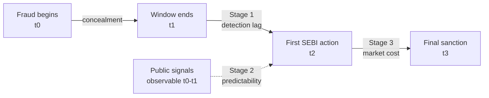
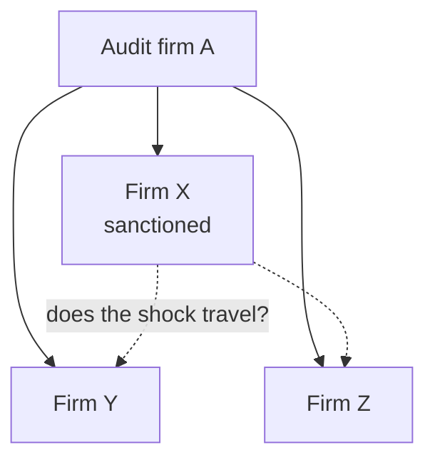

# Detection, Prediction and Deterrence: Where India's Capital Market Fraud Enforcement Chain Leaks

Sep 20, 2026 · @prakhar

Indian capital-market enforcement is routinely described as reactive rather than preventive. The claim is asserted everywhere and measured nowhere. This thesis measures it, by decomposing enforcement into three links — whether a fraud was predictable from public information before anyone caught it, how long it stayed hidden once underway, and whether the sanction that eventually landed imposed any cost — and identifying which link actually leaks.

## 1. Research question and motivation

**Where does India's capital-market fraud enforcement chain actually fail — at prediction, at detection, or at punishment?**

Every diagnosis of Indian securities enforcement reaches the same verdict: it is post-hoc. Regulators arrive after the money is gone. The verdict is plausible and almost certainly right in direction, but it has never been given a magnitude, and without a magnitude it cannot guide policy. "Detect fraud earlier" is not a reform. Knowing that the median fraud stays hidden for *N* months, that *X* percent of it was visible in published accounts beforehand, and that the eventual penalty costs the firm *Y* percent of market value — that is a reform agenda, because it says which of the three links to spend money on.

The gap matters because the unobserved part of the problem is large. For the United States, Dyck, Morse and Zingales (2024) estimate that only about one-third of corporate fraud is ever detected (95% CI: 24–45%), that roughly 10% of large listed firms commit securities fraud in a given year, and that fraud destroys about 1.6% of equity value annually. No comparable estimate exists for India. Whatever the Indian figures are, they are not knowable from enforcement records alone — which is precisely why a study built only on detected cases must be designed around that limitation rather than ignore it.

### The measurement that is available

SEBI enforcement orders state the period investigated. That single institutional fact makes the enforcement chain measurable. In the Taksheel Solutions matter, for instance, the order records an investigation period running from May 2011 to December 2011; the adjudication order followed in June 2014, and a remand order in 2021. That is roughly two and a half years from the close of the violation window to first sanction, and a decade to final resolution — for one IPO-proceeds diversion case. Repeated across a corpus of orders, this becomes a distribution, and the distribution is the object of study.

### Three questions, one chain

The thesis decomposes enforcement into three sequential links and asks one question of each:

1. **Prediction.** Conditional on a fraud later being established, was it visible in public information *before* anyone acted on it — and at what false-positive cost to a regulator with finite inspection capacity?
2. **Detection.** How long does an established fraud remain unaddressed, what explains variation in that lag, and which channel — market surveillance, complaint, audit, or media — is doing the catching?
3. **Deterrence.** When a sanction finally lands, does it impose a measurable cost on the firm, and does that cost travel to other firms connected through shared auditors and shared directors?

The three answers combine into a single diagnosis. If frauds turn out to be predictable but detection is slow, the binding constraint is screening capacity, and the policy is surveillance. If detection is reasonably fast but sanctions are weak, the constraint is deterrence, and the policy is penalty design. If frauds are genuinely unpredictable ex ante, then preventive screening is the wrong ambition altogether and resources belong in ex-post recovery. These are mutually exclusive conclusions with different price tags, and the data can distinguish between them.

## 2. Contribution

The fraud-detection literature is large, rigorous, and almost entirely American. The enforcement-lag literature barely exists anywhere. This thesis contributes on four fronts.

**First, it measures detection lags in an emerging market for the first time.** The prediction literature — [Beneish (1999)](https://www.jstor.org/stable/4480190), [Dechow, Ge, Larson and Sloan (2011)](https://onlinelibrary.wiley.com/doi/abs/10.1111/j.1911-3846.2010.01041.x), [Bao, Ke, Li, Yu and Zhang (2020)](https://onlinelibrary.wiley.com/doi/abs/10.1111/1475-679X.12292) — asks whether fraud is detectable, and answers with classification accuracy. It does not ask how long detection actually took. Duration is the policy-relevant quantity, because the harm from fraud accrues while it is undetected, and no existing paper estimates its determinants for India.

**Second, it calibrates fraud prediction to Indian ownership structure, with a real control group.** The existing Indian work applies Beneish's M-score descriptively to index constituents and reports how many firms cross a threshold. That is not prediction: there is no held-out period, no control group, and no false-positive accounting. More substantively, the US models were estimated on dispersed-ownership firms where the characteristic fraud is managerial earnings manipulation to hit market expectations. India's characteristic fraud is promoter expropriation — the tunnelling that [Bertrand, Mehta and Mullainathan (2002)](https://academic.oup.com/qje/article-abstract/117/1/121/1851754) documented in Indian business groups. Accrual-based signals are tuned for the former and may be close to uninformative for the latter. Testing whether US-calibrated models transfer, and building the India-specific alternative if they do not, is a substantive contribution rather than a replication.

**Third, it provides the first evidence on whether SEBI sanctions impose costs.** [Karpoff, Lee and Martin (2008)](https://www.cambridge.org/core/journals/journal-of-financial-and-quantitative-analysis/article/cost-to-firms-of-cooking-the-books/4BFFF52B30A4997F2ED5EA8BDA69CD1A) showed that for US firms the reputational penalty from misconduct dwarfs the legal one. Whether anything comparable operates in India — where promoter control insulates management from the market for corporate control — is unknown and directly testable. The deterrence premise underlying every call for tougher enforcement depends on the answer.

**Fourth, the spillover extension applies network methods to Indian audit and board structure.** [Beatty, Liao and Yu (2013)](https://ideas.repec.org/a/eee/jaecon/v55y2013i2p183-205.html) established that fraud revelation moves peer firms' investment; [Khanna, Kim and Lu (2015)](https://onlinelibrary.wiley.com/doi/abs/10.1111/jofi.12243) showed that executive network connectedness predicts fraud incidence. Neither has an Indian counterpart, and India's dense director-interlock structure across business groups makes it an unusually good setting to look for contagion through shared auditors and shared boards.

### A by-product worth stating

The corpus itself is a contribution. There is no machine-readable dataset of Indian securities enforcement. Building one — orders parsed into structured fields covering entity, violation type, violation window, order dates, sanction type and amount — creates a research asset that outlives the thesis and can be released alongside it. This is also the most defensible answer to the question every examiner asks about a student thesis: what exists at the end that did not exist before.

## 3. Conceptual framework: the enforcement chain

The three stages are not three topics. They are three terms in one deterrence condition, which is what holds the thesis together as a single argument.

Following the standard economics of enforcement, a promoter commits fraud when the private benefit exceeds the expected cost. The expected cost is the probability of being caught, multiplied by the sanction if caught, discounted by how long the sanction takes to arrive:

```latex
\underbrace{p(\mathbf{x})}_{\text{Stage 2: predictability}} \;\cdot\; \underbrace{S}_{\text{Stage 3: sanction}} \;\cdot\; \underbrace{e^{-r\tau}}_{\text{Stage 1: delay}} \;>\; B
```

Fraud is deterred when this inequality holds. Each stage of the thesis estimates one term.

The framework earns its place by making one point that the reactive-enforcement critique misses. Delay does not merely postpone justice — it **erodes deterrence exponentially**, even holding the detection probability and the penalty fixed. A penalty of ₹26 crore arriving two and a half years late is, to a promoter discounting at any plausible rate, a substantially smaller penalty. So "enforcement is slow" and "enforcement is weak" are not two complaints. Slowness *is* a form of weakness, and the thesis can quantify how much of the weakness it accounts for.

### The chain, and where each stage measures it



The solid path is what the enforcement record shows. The dotted path is the counterfactual the thesis tests: whether the information needed to reach *t2* sooner was already sitting in published accounts during the violation window.

### What each stage estimates

| Stage | Quantity | Estimator | Primary data |
| --- | --- | --- | --- |
| 1. Detection | Lag from t1 to t2, and its determinants | Cox proportional hazards; competing risks by channel | SEBI order corpus + firm covariates |
| 2. Prediction | Achievable p(**x**) at a given screening capacity | Penalised logit and gradient boosting, out-of-time; bivariate probit for robustness | Fraud firm-years vs. full listed panel |
| 3. Deterrence | Market-value cost S of a sanction | Event study on abnormal returns; cross-sectional regression on CAR | Order dates + daily prices |

### Why the three must be estimated together

Any one stage alone gives a misleading policy conclusion. High predictability with fast detection would mean the system works and the critique is wrong. High predictability with slow detection indicts screening capacity specifically. Low predictability with slow detection means preventive screening is the wrong instrument and the money belongs in forensic capacity and recovery. Fast detection with no market penalty means the problem is sanction design, not surveillance at all. Only the joint pattern identifies the binding constraint — which is the deliverable the original ICAI framing wanted but could not reach by case study.

## 4. Data

### 4.1 The SEBI enforcement corpus

The spine of the thesis is a machine-readable corpus built from [SEBI's enforcement orders database](https://www.sebi.gov.in/sebiweb/home/HomeAction.do?doListing=yes&sid=2&ssid=9&smid=2), which currently holds **6,424 order records**. The database is searchable by title, keyword and entity name, filterable by date range and issuing department, and paginated at 25 records per page. Order documents are served as PDFs under a stable path pattern (`sebi.gov.in/sebi_data/attachdocs/<month-year>/<id>.pdf`), which makes systematic retrieval straightforward.

The database mixes ten order categories. Orders under the RTI Act and orders on corporatization and demutualization schemes are excluded as irrelevant. The analytical sample is drawn from Orders of the Adjudicating Officer, Orders of the Chairperson and Whole-Time Members, Orders of ED/CGM quasi-judicial authorities, and Settlement Orders. Orders of SAT and of the courts are retained separately, as appellate outcomes rather than sample members — they are needed to identify sanctions later reversed.

Two supplementary official sources sharpen the corpus. SEBI publishes downloadable **11B order summary spreadsheets by year for 2014–2022**, which give structured metadata for cross-validating the extraction. And SEBI's Annual Report carries its own categorized enforcement tables, including Table 10.5 (Fraudulent and Unfair Trade Practices cases), Table 10.6 (Financial Statements Fraud cases), and age-wise analyses of adjudication and prosecution proceedings in Tables 10.10 and 10.11. The [2025–26 Annual Report](https://www.sebi.gov.in/reports-and-statistics/publications/aug-2026/SEBI%20ANNUAL%20REPORT%202025_26.pdf) records 402 investigations taken up and 338 completed in that year. These tables provide an independent benchmark: if the constructed corpus does not reproduce SEBI's own published counts by year and category, the extraction is wrong.

### 4.2 Fields extracted from each order

| Field | Type | Source in order | Use |
| --- | --- | --- | --- |
| Entity name, PAN/CIN | String | Header and parties | Link to financial data |
| Order date | Date | Header | Defines t2 / t3 |
| Violation window start, end | Date | "investigation period" / "examination period" clause | Defines t0, t1 — critical |
| Regulations invoked | Categorical | Operative section | Fraud typology |
| Fraud category | Categorical | Narrative, coded | Stratification |
| Detection trigger | Categorical | Narrative, coded | Competing-risks channel |
| Penalty amount | ₹ | Operative order | Sanction magnitude S |
| Non-monetary sanction | Categorical | Operative order | Debarment, disgorgement |
| Parties sanctioned | Count and role | Parties | Promoter, auditor, intermediary |
| Prior interim order reference | Date | Narrative | Earlier t2 if one exists |

### 4.3 The critical construction decision

**Frauds are dated to the violation window, not the order date.** This sounds procedural and is the single choice on which the thesis stands or falls.

If a fraud firm-year is labelled by the year SEBI issued its order, every predictor is measured *after* the fraud was public, and any model built on it achieves excellent accuracy by learning the consequences of detection rather than the antecedents of fraud. That error — look-ahead contamination — is the most common defect in applied fraud-prediction work and it inflates performance dramatically. Dating to the violation window means predictors are drawn strictly from information published while the fraud was live and undetected, which is the only sample on which a preventive screen could actually have operated.

The verified Taksheel order illustrates the gap: violation window May–December 2011, order June 2014. Labelling that firm as fraudulent in 2014 rather than 2011 would misplace it by three years and destroy the exercise.

Extraction of the window is a natural-language task over unstructured PDFs, and it will not be perfect. The mitigation is a hand-validated random subsample of 150 orders, with extraction accuracy reported explicitly and the main results re-run on the hand-coded subset as a robustness check.

### 4.4 Firm-level and market data

| Requirement | Primary source | Fallback if primary unavailable |
| --- | --- | --- |
| Annual financials, listed panel | CMIE Prowess or Capitaline | Screener.in plus BSE-hosted annual reports |
| Daily prices, index returns | NSE and BSE bhavcopy archives | Same — these are free and complete |
| Ownership, promoter pledging | Quarterly shareholding filings on BSE/NSE | Same |
| Auditor identity per firm-year | Annual report audit report page | Prowess auditor field where available |
| Directors and interlocks | MCA DIN records; annual reports | Prowess directors database |
| Corporate announcements, auditor resignations | NSE/BSE announcement archives | Same |

The fallback column is not decoration. Section 10 sets out why every stage is designed to survive on free sources alone.

### 4.5 Sample

The target analytical sample is orders concerning **listed issuers** over roughly 2010–2025, which is the period for which both order coverage and firm financials are reliable. Orders against individual intermediaries, brokers and unconnected traders are retained in the corpus but excluded from the firm-level stages, since they have no issuer to match to financial data.

The corpus scoping exercise in the first month establishes the realised counts. On the basis of the 6,424 total and the category mix, a listed-issuer sample in the high hundreds to low thousands is the working expectation, against a control panel of all listed non-fraud firm-years over the same period. Precise figures are deliberately not asserted here; the scoping deliverable reports them before the empirical work is committed.

## 5. Stage 1 — Detection lags

### 5.1 The quantity

For each fraud *i*, the detection lag is the time from the close of the violation window to the first regulatory action against the entity:

```latex
T_i \;=\; t^{\text{first action}}_i \;-\; t^{\text{window end}}_i
```

The first action is the earliest of an interim order, a show-cause notice date recited in the order, or the adjudication order itself. Where an order recites a prior interim order, that earlier date governs — otherwise the lag is inflated by adjudication time, which is a separate delay with separate causes. The thesis reports both: **detection lag** (window end to first action) and **resolution lag** (first action to final order), because conflating them is exactly the error that makes "enforcement is slow" unactionable.

### 5.2 Estimation

The baseline is a Cox proportional hazards model for the instantaneous rate of detection:

```latex
h_i(t \mid \mathbf{x}_i) \;=\; h_0(t)\,\exp\!\left(\mathbf{x}_i'\boldsymbol{\beta}\right)
```

A Weibull accelerated failure time specification is estimated alongside it, since AFT coefficients read directly as proportional changes in expected time-to-detection, which is the more interpretable form for a policy audience. Agreement between the two is itself a specification check.

**Covariates** are grouped by the mechanism each is meant to capture:

- *Visibility*: log market capitalisation, index membership, institutional shareholding, trading turnover, analyst following where obtainable.
- *Gatekee*ping: Big-4-affiliated auditor, auditor tenure, prior audit qualification, auditor resignation during the window.
- Opacity and control: promoter shareholding, promoter share pledging, business-group affiliation, related-party transaction intensity, subsidiary count.
- Fraud characteristics: typology (accounting misstatement, IPO proceeds diversion, market manipulation, insider trading, disclosure failure), amount involved, number of parties, whether an intermediary or auditor was implicated.
- Regime: indicators for the post-LODR 2015 and post-NFRA 2018 periods, to test whether detection accelerated after the major governance and audit-oversight reforms.

### 5.3 Competing risks: who actually catches fraud

The detection channel is coded from each order's narrative into six mutually exclusive categories: exchange or SEBI surveillance alert; complaint or whistleblower; auditor qualification or resignation; media or research-report exposure; referral from another agency (MCA, RBI, income tax, SFIO); and voluntary company disclosure.

These are modelled as competing risks, with cause-specific Cox hazards as the baseline and Fine–Gray subdistribution hazards for the cumulative incidence of each channel. The policy content is direct. If surveillance accounts for a small share of first detections while complaints and media account for most, then investment in automated surveillance is not where the marginal detection is coming from, whatever the stated strategy says.

### 5.4 The truncation problem, and its treatment

This is the stage's main statistical threat and it needs stating plainly rather than burying in a limitations paragraph.

The sample contains only frauds detected by the corpus cut-off date. A fraud whose window closed in 2023 and which will be detected in 2029 is absent. This is **right truncation**, not ordinary right censoring, and it biases the observed lag distribution downward for recent cohorts — recent years appear to have faster detection purely because slow detections have not happened yet.

Three treatments, reported together:

1. **Cohort restriction.** The primary estimates use violation windows closing on or before a cut-off that leaves a minimum follow-up period (provisionally eight years, set once the empirical lag distribution is known). Later cohorts are reported descriptively but excluded from the hazard estimates.
2. **Truncation-adjusted estimation.** Reverse-time Kaplan–Meier methods developed for right-truncated data give a non-parametric estimate of the lag distribution that corrects for the induced bias; these are reported alongside the naive estimate so the size of the distortion is visible.
3. **Regime-effect caution.** Because truncation mechanically mimics improving detection speed, any finding that post-2018 detection is faster is treated as unproven unless it survives on the cohort-restricted sample. This is stated in advance so the result cannot be over-read.

### 5.5 What Stage 1 produces

A distribution of detection lags for Indian capital-market fraud with a central estimate and dispersion; a ranked set of firm and fraud characteristics that predict faster or slower detection; and a decomposition of first detections by channel. Each is a number that does not currently exist for India.

## 6. Stage 2 — Ex-ante predictability

### 6.1 Design

The unit of observation is the **firm-year**. A firm-year is labelled fraudulent if it falls inside a violation window later established by a SEBI order, and clean otherwise. The control group is the full population of listed non-fraud firm-years over the same period — not a matched subsample, which discards the information about base rates that the exercise exists to recover.

This is the design correction that separates the thesis from the original draft. A study of fifty established frauds can describe what frauds look like. It cannot say whether clean firms look the same, and therefore cannot produce a usable screen.

### 6.2 Predictors

All predictors are measured from information published during or before the violation year, with a lag that reflects real filing dates rather than fiscal-year ends. Four families:

- *Accrual and earnings quality*: the eight Beneish M-score components, the Dechow F-score inputs, total and discretionary accruals, cash-flow-to-earnings divergence, revenue-to-receivables dynamics.
- *Ownership and control*: promoter shareholding, promoter share pledging, business-group affiliation, related-party transaction intensity, subsidiary and step-subsidiary counts, cross-holdings.
- *Audit and governance*: auditor identity and tenure, mid-term auditor resignation, audit qualification, adverse internal-financial-controls opinion, board independence, board meeting attendance, audit-committee composition.
- *Market signals*: returns and volatility, turnover anomalies, price-volume divergence, delivery-to-traded-volume ratio, unusual pre-announcement trading.

The ownership and audit families are the India-specific content. If the thesis finds that these outperform the imported accrual measures, that result alone answers a question the literature has not asked.

### 6.3 Models and the transfer test

Five specifications, in increasing flexibility:

1. **Beneish M-score, original coefficients.** A pure transfer test — does a model fitted on 1980s–90s US data classify Indian fraud?
2. **Dechow F-score, original coefficients.** Same test, different vintage and construction.
3. **Logit, re-estimated on Indian data** using the same inputs. Separates "wrong coefficients" from "wrong variables".
4. **Penalised logit (LASSO)** over the full India-specific predictor set, which gives an interpretable sparse model a regulator could actually publish.
5. **Gradient-boosted trees**, with class-imbalance handling of the kind [Bao et al. (2020)](https://onlinelibrary.wiley.com/doi/abs/10.1111/1475-679X.12292) applied to US data. Their [2022 erratum in the same journal](https://onlinelibrary.wiley.com/doi/10.1111/1475-679X.12454) is a useful caution on implementation error in exactly this kind of pipeline, and the replication code they released is a sensible reference implementation.

**Validation is strictly out-of-time, never random-split.** Models are trained on violation years up to a cut-off and evaluated on later years only. A random split would let the model learn from the future and is the second most common defect in this literature after look-ahead labelling.

### 6.4 Evaluation: the capacity-constrained frontier

Fraud is rare, so classification accuracy is meaningless — a model predicting "no fraud" everywhere scores above 95%. AUC is reported for comparability with the literature but is also misleading under this degree of imbalance. The headline metric is different and it is the stage's main contribution.

A regulator does not choose a probability threshold. It has an inspection budget and works down a ranked list. SEBI's own Annual Report gives the budget: **402 investigations taken up in 2025–26**, against a listed universe of several thousand companies. So the policy-relevant question is precise:

> If SEBI ranked every listed firm by this model each year and investigated the top 400, what fraction of the frauds actually committed that year would it have reached?

The thesis reports recall as a function of inspection capacity *k*, sweeping *k* across the plausible range and marking SEBI's actual realised capacity on the curve. Area under the precision-recall curve supplements it. This converts an accuracy statistic into a resourcing statement, and it is the form in which a screening result is usable by the institution the ICAI draft was addressed to.

### 6.5 Partial observability

Every result above is conditional on detection. The labels are not "fraud" but "fraud that SEBI caught and sanctioned", and clean-labelled firm-years include undetected frauds. For the US, [Dyck, Morse and Zingales (2024)](https://link.springer.com/article/10.1007/s11142-022-09738-5) put the undetected share at roughly two-thirds.

The robustness treatment follows [Wang, Winton and Yu (2010)](https://onlinelibrary.wiley.com/doi/abs/10.1111/j.1540-6261.2010.01615.x) in modelling commission and detection as separate latent processes, with the fraud label observed only when both occur:

```latex
\begin{aligned}
z^{C*}_{it} &= \mathbf{x}_{it}'\boldsymbol{\beta}_C + \varepsilon^C_{it} \quad \text{(commission)}\\
z^{D*}_{it} &= \mathbf{w}_{it}'\boldsymbol{\beta}_D + \varepsilon^D_{it} \quad \text{(detection)}\\
y_{it} &= \mathbf{1}\{z^{C*}_{it}>0\}\cdot\mathbf{1}\{z^{D*}_{it}>0\}
\end{aligned}
```

Identification requires variables entering detection but not commission. The candidates are visibility and enforcement-capacity measures — index membership, analyst following, exchange surveillance intensity, and regional caseload — and Stage 1's channel estimates inform which are defensible.

This is presented as a **robustness exercise with acknowledged identification weakness, not a headline result**. Exclusion restrictions in partial-observability models are contestable by construction, and claiming otherwise would be the kind of overreach this proposal is written to avoid. Its role is to show whether the main conclusions are sensitive to the selection problem, and to bound how sensitive.

## 7. Stage 3 — Sanctions and deterrence

### 7.1 Core: does a SEBI order cost anything?

Abnormal returns are computed against a market model estimated over a clean pre-event window:

```latex
AR_{it} \;=\; R_{it} - \left(\hat{\alpha}_i + \hat{\beta}_i R_{mt}\right), \qquad
CAR_i(\tau_1,\tau_2) \;=\; \sum_{t=\tau_1}^{\tau_2} AR_{it}
```

Three event types are treated separately because their information content differs sharply. **Interim orders** are usually the first public signal and carry the most news. **Final adjudication orders** are partly anticipated. **Settlement orders** resolve uncertainty and may even be received positively. Pooling them would average away the effect.

Cross-sectional determinants of CAR are then estimated:

```latex
CAR_i \;=\; \gamma_0 + \gamma_1 \log(\text{Penalty}_i) + \gamma_2 \, \text{Debarment}_i + \gamma_3 \, \text{PromoterNamed}_i + \mathbf{x}_i'\boldsymbol{\gamma} + \varepsilon_i
```

The coefficient of interest is not γ₁. It is the gap between the total market-value loss and the monetary penalty — the reputational component that [Karpoff, Lee and Martin (2008)](https://www.cambridge.org/core/journals/journal-of-financial-and-quantitative-analysis/article/cost-to-firms-of-cooking-the-books/4BFFF52B30A4997F2ED5EA8BDA69CD1A) found dominates the legal one in the United States. Whether it exists in a market where promoters retain control regardless of market discipline is the open question.

### 7.2 Two problems specific to this sample

Fraud firms are not representative firms, and the event study has to be built around that.

**Thin trading.** Many sanctioned issuers are small-cap and illiquid, where standard beta estimates are biased by non-synchronous trading. Dimson and Scholes–Williams corrected betas are used, and results are reported separately for a liquid subsample defined on pre-event trading frequency.

**Trading suspension.** Some firms are suspended from trading precisely when the order lands, so returns are missing exactly at the event. Dropping them silently would select on the outcome — the most severe cases would vanish from a study of severity. The thesis reports the suspended set explicitly, treats suspension as an outcome in its own right with its own determinants, and bounds the main estimate under assumptions about the returns that would have been observed.

### 7.3 Extension: does enforcement have a multiplier?

**Conditional component — attempted only if the core is complete and the auditor data is cheap. See §11.**

#### The question, and why it matters

The event study in §7.1 measures what a sanction costs *the sanctioned firm*. That is a narrow test of deterrence, because SEBI sanctions a few hundred entities a year against a universe of several thousand listed companies. If the only firm affected is the one punished, enforcement is retail punishment: its total deterrent value is roughly the sum of the penalties, which is small.

The alternative is that a sanction carries information about firms that were *not* sanctioned, and those firms get repriced or change their behaviour. If so, enforcement has a multiplier, and its real value is far larger than the penalty ledger suggests. **That multiplier is the thing this extension measures.** It is the difference between enforcement as punishment and enforcement as a signal.

#### The mechanism

The cleanest channel runs through the auditor. Suppose audit firm A signs the accounts of companies X, Y and Z. SEBI sanctions X for accounting fraud that A's audit did not catch.



A rational investor holding Y or Z learns something from the sanction on X. The reliability of Y's and Z's accounts depends on A's diligence, and the sanction is evidence that A's diligence is lower than believed. Y and Z should fall even though neither did anything wrong. This is the same updating that repriced Arthur Andersen's other clients after Enron.

The director-interlock channel works the same way. If a person sits on the boards of both X and Y, sanctioning X is evidence about the governance standards that person tolerates, and therefore about Y.

#### How the graph is actually used

This is the part the earlier draft left implicit. Two graphs are built from firm-year data:

- **Auditor network.** A bipartite graph with companies on one side and audit firms on the other, an edge where an audit firm signed that company's accounts that year. Projecting it onto companies gives a company-to-company graph in which two companies are adjacent if they shared an auditor.
- **Director network.** Companies as nodes, an edge between two companies when a person (identified by DIN) sits on both boards.

The basic test then needs only the first neighbourhood. For each sanction on firm X at date *d*:

- **Treated**: companies at graph distance 1 from X — same auditor, or a shared director.
- **Control**: companies at distance greater than 2, matched to the treated set on industry, size and pre-event returns.
- **Test**: is CAR(treated) − CAR(control) negative over the event window?

#### Why this needs a graph rather than a dummy variable

A binary "connected / not connected" indicator would answer the basic question. The reason to build the actual network is that **topology generates predictions that a dummy cannot make, and those predictions are what separate a real effect from a confounded one.**

Three in particular:

1. **Distance decay.** A genuine information effect should weaken with graph distance — strong at distance 1, weaker at distance 2 (the other clients of the other auditors of X's peers), absent beyond. A confound like shared industry exposure has no reason to decay in graph distance specifically. Measuring the gradient is therefore a test, not a description.
2. **Degree heterogeneity.** Does a sanction transmit more through a small audit firm with eight clients than through a large one with two hundred? The reputational-updating story predicts more transmission through low-degree auditors, because one bad client is a larger share of the evidence about them. Getting the *direction* of this right is a demanding test of the mechanism.
3. **Cluster structure.** Indian business groups form dense clusters in the director graph. Does a sanction inside a dense cluster transmit more than one at the periphery? This connects the result back to the group-tunnelling literature.

#### The falsification test

The risk is obvious: auditors and business groups cluster by industry and size, so "connected" firms may simply be similar firms moving together for unrelated reasons.

The discipline is **degree-preserving rewiring**. Randomly rewire the auditor-client edges while holding each auditor's client count and each company's auditor count fixed. This destroys the real connections but preserves the degree distribution entirely. Recompute the treated sets on the fake graph and re-run the test, several hundred times, to build a null distribution.

If the measured effect sits inside that null distribution, it was never about who is connected to whom — it was about the characteristics of firms that happen to be well connected, and the finding is dead. If it sits outside, the effect is attributable to the actual edges. This is a stronger falsification than a matched control group alone, and it is only available because the network was built.

Two further placebos: pseudo-event dates drawn from non-event periods, and auditor links formed only *after* the violation window closed, which should show nothing.

### 7.4 Synthesis: the implied optimal penalty

The three stages close on a single calculation, which is the thesis's intended punchline.

Under the standard deterrence result, the penalty that makes an offence unprofitable is the harm divided by the probability of being caught:

```latex
S^{*} \;=\; \frac{H}{p} \cdot e^{\,r\tau}
```

Every term becomes estimable. Stage 3 gives *H* as the market-value destruction around revelation. Stage 2 bounds *p* through the achievable detection rate at realistic inspection capacity. Stage 1 gives the delay τ. Against these, the penalties SEBI actually imposes are observed directly in the corpus.

The comparison between the implied *S*\* and observed penalties is a concrete, defensible policy finding, and it is exactly what the original draft wanted to assert but had no way to compute. If observed penalties fall an order of magnitude short of the implied optimum, that is a quantified case for penalty reform. If they do not, the binding constraint lies in detection and the reform agenda shifts accordingly. Either way the thesis answers rather than recommends.

## 8. Hypotheses and falsification criteria

Each hypothesis is stated as a restriction on an estimated parameter, with the result that would reject it specified in advance. This is the substantive departure from the original draft, whose hypotheses were phrased as possibilities ("may enable", "can play a vital role") and could not be rejected by any finding.

| # | Hypothesis | Testable restriction | Rejected if |
| --- | --- | --- | --- |
| H1 | Fraud is predictable from public information before detection | Out-of-time recall at inspection capacity k=400 exceeds random ranking; AUPRC exceeds the base rate | Out-of-time performance is statistically indistinguishable from ranking firms at random |
| H2 | Detection has not accelerated despite the post-2015 and post-2018 reforms | Hazard ratio on post-LODR and post-NFRA cohort indicators equals 1 | Hazard ratio significantly above 1 on the cohort-restricted sample |
| H3 | Audit signals carry independent detection information | Non-zero coefficients on auditor resignation and qualification in the hazard model; non-zero marginal AUPRC contribution in Stage 2 | Audit variables add nothing to either the hazard or the screen once other covariates are included |
| H4 | Automated surveillance is not the dominant first-detection channel | Cumulative incidence share of the surveillance channel is below 50% | Surveillance accounts for a majority of first detections |
| H5 | Ownership opacity predicts both fraud incidence and slower detection | Promoter pledging, RPT intensity and group affiliation are non-zero in Stage 1 and Stage 2 | Null in both stages |
| H6 | Sanctions impose market costs exceeding the monetary penalty | CAR around interim orders is negative, and the implied value loss materially exceeds the penalty | CAR is statistically indistinguishable from zero |
| H7 | Sanctions transmit through auditor and director networks (extension) | Connected-firm CAR is more negative than matched unconnected firms, surviving the rewiring placebo | No difference, or the effect disappears under placebo |

### Why the nulls are informative

The design is deliberately built so that every hypothesis is worth testing in either direction. This matters because a thesis whose contribution depends on finding an effect is a thesis at risk.

- **H1 rejected** would be a substantial finding: it would say preventive accounting-based screening is not achievable in India from public data, and that resources belong in forensic and recovery capacity rather than early-warning systems. That directly contradicts the premise of the original draft, which is precisely why it must be testable.
- **H2 not rejected** confirms reform ineffectiveness with a magnitude attached. **H2 rejected** would show the reforms worked and reframe the policy conversation.
- **H4 rejected** would mean surveillance is doing the work after all, and the reactive-enforcement critique targets the wrong mechanism.
- **H6 rejected** would be the most consequential null in the thesis. It would mean market discipline does not operate on Indian promoters, that reputational penalties cannot be relied on, and that statutory penalty design carries the entire deterrence burden — a conclusion with direct implications for how SEBI sets penalties.

No single result is load-bearing for the thesis's contribution. The contribution is the measured chain.

## 9. Threats to validity

| Threat | Why it matters | Treatment |
| --- | --- | --- |
| Selection on detection | Labels are "fraud SEBI caught", not "fraud". Clean-labelled firm-years contain undetected fraud | All claims stated as conditional on detection; bivariate probit robustness (§6.5); no claim about fraud prevalence |
| Right truncation | Recent cohorts mechanically show faster detection because slow detections have not occurred yet | Cohort restriction with minimum follow-up; reverse-time Kaplan–Meier adjustment; regime findings require the restricted sample (§5.4) |
| Extraction error | Violation windows are parsed from unstructured PDFs | 150-order hand-validated subsample; accuracy reported; main results re-run on hand-coded data |
| Look-ahead labelling | Dating fraud to the order year lets predictors see the future | Violation-window dating throughout; predictors lagged to real filing dates (§4.3) |
| Survivorship in financial data | Fraud firms are disproportionately delisted, and commercial databases drop delisted firms | Point-in-time construction where possible; archived annual reports and exchange filings for delisted names; delisting treated as an observed outcome, not a dropped row |
| Confounded event windows | Orders may coincide with earnings, resignations or media exposure | Interim orders prioritised as the cleanest signal; announcement archives screened for same-window events; contaminated events reported and excluded in a robustness cut |
| Coding subjectivity | Fraud typology and detection channel are judgement calls | Written coding protocol fixed before coding; a dual-coded subsample with Cohen's kappa reported; ambiguous cases resolved to a residual category rather than forced |
| Multiple testing | Many covariates across three stages invites false positives | Primary hypotheses pre-specified in §8; secondary findings labelled exploratory and adjusted for the false discovery rate |
| Jurisdictional scope | Frauds handled by MCA, SFIO or RBI are outside the corpus | Stated as a scope condition, not a defect: the thesis is about securities-market enforcement by SEBI, and claims are confined accordingly |

### Limitations that cannot be engineered away

Two deserve naming as genuine boundaries rather than treated threats.

**Fraud prevalence is not estimable here.** [Dyck, Morse and Zingales (2024)](https://link.springer.com/article/10.1007/s11142-022-09738-5) could estimate the undetected share for the United States only because the collapse of Arthur Andersen in 2001 created a natural experiment: a set of firms whose books were suddenly examined by fresh auditors, revealing frauds that would otherwise have stayed hidden. This thesis has no such shock in hand and therefore makes no prevalence claim.

*A possible route worth investigating, flagged as unverified.* SEBI's action against PwC-affiliated audit firms following the Satyam matter, and the establishment of NFRA in 2018, may have produced comparable forced-scrutiny episodes in India. If a subset of firms underwent auditor replacement for reasons unrelated to their own conduct, the same identification becomes available. This is noted as a possible extension **requiring independent verification of the facts and timing before it is relied on** — it is not part of the committed design.

**Causality is limited outside Stage 3.** Stage 1 estimates conditional associations between firm characteristics and detection speed, not causal effects of those characteristics. A firm with a Big-4 auditor detected faster may differ on unobservables that drive both. The proposal does not claim otherwise, and the language of the eventual thesis should not drift into causal phrasing. Where causal claims are made — the event study, and the placebo-disciplined spillover tests — they rest on a dated shock and an explicit comparison group.

## 10. Data access plan

### 10.1 The governing rule

**Every stage of this thesis runs to completion on public data alone.** Institutional access from the ICAI and SEBI contacts is treated as an upgrade that sharpens specific estimates, never as a dependency.

This is not excessive caution. A research design built on promised data is a design that fails silently in month six, when the data has not arrived, the fallback was never scoped, and there is no time left to rebuild. Institutional data provision is subject to internal approvals, confidentiality protocols and staff availability, none of which are under the researcher's control. The rule below is therefore structural, not procedural: **no committed hypothesis in §8 depends on non-public data.**

### 10.2 What to request, ranked by research value

| Request | What it enables | Fallback if declined |
| --- | --- | --- |
| Internal investigation initiation dates | Splits the observed lag into true detection lag (window end → SEBI learns) and processing lag (learns → order). This is the single highest-value item — it converts Stage 1's dependent variable from a composite into the quantity of interest | Composite lag from first public action; processing lag approximated from show-cause-notice dates recited in orders |
| Cases examined and closed without action | Supplies the missing cell: firms SEBI looked at and cleared. Enables a true detection-stage model rather than one conditioned on sanction | Not recoverable publicly; the detection stage is estimated conditional on sanction and framed accordingly |
| Source of first information per case | Makes the competing-risks channel coding observed rather than inferred from narrative | Channel coded from order text with inter-coder reliability reported (§9) |
| 11B order summaries after 2022 | Extends structured metadata coverage to the present | Extraction from order PDFs, validated against the public 2014–2022 spreadsheets |
| ICAI or NFRA auditor disciplinary records | Links audit quality to fraud outcomes at the audit-firm level | NFRA published orders and SEBI orders naming auditors |
| Database access via ICAI (Prowess or Capitaline) | Clean panel financials at scale | Screener.in plus BSE-hosted annual reports; slower to assemble, adequate in coverage |

### 10.3 The public-data floor

If nothing is provided, the thesis still runs. The free stack is:

- **Enforcement**: SEBI orders database and order PDFs; SEBI Annual Report tables; the public 11B summary spreadsheets for 2014–2022.
- **Prices**: NSE and BSE bhavcopy archives — complete, free, and sufficient for the entire event study.
- **Financials**: Screener.in and annual report PDFs hosted on BSE, parsed into a panel. This is the most labour-intensive substitution and the main reason the timeline front-loads data construction.
- **Ownership and governance**: quarterly shareholding-pattern filings and annual reports, both public on the exchanges.
- **Directors**: DIN records and annual report disclosures.

Coverage, not existence, is what degrades without commercial data — chiefly for small-cap and delisted firms, which matters because fraud firms are disproportionately in that group. Any resulting coverage gap is measured and reported rather than assumed away.

### 10.4 Handling non-public material

Three commitments, to be agreed in writing with both contacts before any non-public data changes hands:

1. Non-public data is used in aggregate only. No case detail that is not already in a published order appears in the thesis.
2. Any provided dataset is described in the thesis by its fields and coverage, so results remain interpretable to readers who cannot access it.
3. Every result that depends on non-public data is also reported on the public-data sample, so the thesis is verifiable by a reader without institutional access.

The third is the one that protects the work. A finding no one else can reproduce is a finding with limited standing, however privileged its source.

## 11. Timeline to 1 December 2026

### 11.1 The budget, and what it forces

Ten weeks remain (22 September – 30 November) at 3–4 hours a day. That is roughly **240 working hours**, and the plan below spends all of them. There is no slack in it, which is itself a design constraint rather than a detail.

The binding cost is not estimation — the models take hours to run once the data exists. It is **data construction**, and within that, the firm-year financial panel. Corpus building, entity matching and panel assembly account for roughly 40% of the total budget before a single coefficient is estimated.

That single fact determines the scope decision, because the three stages differ sharply in how much panel they need:

| Stage | Data it needs | Cost at this budget |
| --- | --- | --- |
| 1. Detection lags | Corpus + light firm covariates | Affordable — the corpus is being built anyway |
| 3. Deterrence | Corpus + daily prices (free from exchange archives) | Affordable — prices are the cheapest data in the project |
| 2. Prediction | Full firm-year panel of accounting variables | **Expensive** — this is where the budget goes |
| Network extension | Auditor identity for every firm-year | **Expensive or free, depending entirely on one thing** |

### 11.2 Scope decision

**Stages 1 and 3 are committed in full.** Both run on the enforcement corpus plus free exchange price data. Together they are already a complete, coherent paper: how long fraud stays hidden, and whether the sanction that eventually arrives costs anything.

**Stage 2 is committed in reduced form.** Predictors are restricted to what is cheap to assemble — promoter shareholding and pledging from quarterly filings, market signals from price and volume data, and audit qualification flags where they are readily available. The full Beneish and Dechow accrual panel is **dropped** unless a database with financial-statement fields is confirmed in week 1. This is a defensible restriction on its own terms, not just a concession: it tests whether ownership and market signals alone carry predictive information, which is the India-specific question anyway.

**The network extension is conditional on one binary fact.** Everything turns on whether auditor identity per firm-year is available as a *database field*. If it is, the auditor-client edges are essentially free and the extension becomes viable in week 9. If it requires parsing several thousand annual-report PDFs, it cannot be done in this window and moves to future work. **On current information, the realistic expectation is that it will not make it in.** It is written into §7.3 so that it is ready if the data arrives, and the paper is complete without it.

### 11.3 Week by week

Each week is approximately 24 hours. Writing runs alongside the empirical work from week 1, never deferred — at this compression, a paper written only at the end is a paper not finished.

| Week | Dates | Work | Written output |
| --- | --- | --- | --- |
| 1 | 22–28 Sep | Scraper and PDF retrieval; text extraction pipeline | Introduction and literature |
| 2 | 29 Sep – 5 Oct | Violation-window extraction; typology and channel coding | Conceptual framework |
| 3 | 6–12 Oct | Hand validation of 150 orders; entity matching to tickers | Data section — **Gate 1, 12 Oct** |
| 4 | 13–19 Oct | Price panel from exchange archives; shareholding data; merge | Data section complete |
| 5 | 20–26 Oct | Stage 1: duration models, competing risks, truncation adjustment | — |
| 6 | 27 Oct – 2 Nov | Stage 1 robustness and specification checks | Stage 1 results — **Gate 2, 2 Nov** |
| 7 | 3–9 Nov | Stage 3: event study across order types; CAR regressions | — |
| 8 | 10–16 Nov | Stage 2 in reduced form; out-of-time validation | Stage 3 results — **Gate 3, 16 Nov** |
| 9 | 17–23 Nov | Synthesis; implied optimal penalty; network extension *only if Gate 3 opened* | Full draft assembled |
| 10 | 24–30 Nov | Revision, robustness checks, final read-through | Submission 1 Dec |

### 11.4 Gates

**Gate 1 — 12 October: does the corpus exist?** Proceed only if violation windows are extracting reliably and the listed-issuer sample is usable. If extraction is failing, abandon automated extraction immediately and hand-code a stratified sample of 300–400 orders instead. That is still eight times the original draft's fifty, and it is achievable in the remaining weeks. **Do not spend week 4 debugging a parser.**

**Gate 2 — 2 November: is Stage 1 done and written?** If Stage 1 results are not drafted by this date, Stage 2 is cut entirely and the paper becomes Stages 1 and 3. This is the most important gate, because Stage 1 is the paper's primary contribution and it must not be crowded out by a more ambitious stage that is running late.

**Gate 3 — 16 November: anything more?** The network extension begins only if Stages 1, 2 and 3 are all drafted and the auditor data proved cheap. Otherwise week 9 goes entirely to synthesis and the extension is described as future work.

### 11.5 Cut order

If a week overruns, the following are dropped in order, first to last:

1. Network extension (§7.3)
2. Partial-observability robustness (§6.5), retained as a discussed limitation
3. Stage 2 entirely — its hypothesis H1 becomes a stated open question
4. Settlement and final-order event windows, retaining interim orders only
5. Competing-risks channel decomposition (§5.3), retaining the pooled hazard model

What remains below item 5 is the irreducible paper: a measured distribution of detection lags with its determinants, and an event study on interim orders. That is deliverable on free data and defensible on its own.

> **One assumption to confirm.** This plan treats 1 December as the deadline for the **full paper**. If it is instead a proposal or interim submission, the schedule relaxes substantially and Stage 2 returns to full scope.

## 12. Deliverables and relationship to the original ICAI proposal

### 12.1 Deliverables

1. **The thesis** — the three-stage empirical study with its synthesis and policy chapter.
2. **The enforcement corpus** — a structured, documented dataset of SEBI enforcement orders with the extraction code, released alongside the thesis. No such resource currently exists for Indian securities enforcement.
3. **A policy note** — a short standalone document written for ICAI and, if appropriate, SEBI: the measured detection lag, the achievable screening performance at realistic inspection capacity, and the implied-versus-observed penalty comparison.
4. **A working paper** — Stage 1 alone is publishable, and is the most natural first submission.

### 12.2 How the original seven objectives are carried forward

The design departs substantially from the draft's method while preserving its subject and most of its intent. The mapping is explicit so the change can be discussed rather than discovered.

| Original objective | Status | How |
| --- | --- | --- |
| 1. Risks in capital raising and utilisation | **Strengthened** | IPO-proceeds diversion becomes a coded fraud typology with its own detection-lag and predictability estimates, rather than an illustrative case |
| 2. Systemic vulnerabilities and regulatory gaps | **Narrowed** | Measured as detection lag, channel decomposition and the implied penalty gap — but confined to SEBI. Inter-agency coordination is dropped: it is not measurable without multi-regulator data that neither the draft nor this design can obtain |
| 3. Types, patterns and trends of fraud | **Strengthened** | Typology coded across the full corpus with trends over fifteen years, instead of fifty selected cases |
| 4. Emerging techniques and digital footprints | **Dropped** | Fintech and social-media manipulation are too thinly represented in the enforcement record to support measurement. Retaining the objective would mean asserting conclusions the data cannot carry. Noted as future work |
| 5. Role of accountants and auditors | **Strengthened** | Becomes hypothesis H3, testing whether audit signals carry independent detection information in both the hazard model and the screen — a measured contribution rather than an affirmed role |
| 6. Role of digital technologies | **Reframed** | The thesis does not survey AI and blockchain; it *applies* machine learning to the problem and reports what it achieves at realistic regulatory capacity. A measured answer replaces a literature review |
| 7. Actionable recommendations | **Preserved, now derived** | The policy chapter follows from estimated quantities, including the implied optimal penalty, rather than preceding them |

### 12.3 What changed, and why

Three changes account for most of the difference.

**The control group.** The draft's fifty established frauds cannot support any statement about what distinguishes fraud from non-fraud, because they contain no non-fraud. Every predictive claim in the original hypotheses requires a comparison population, and the corpus-plus-panel design supplies one.

**The sample size.** SEBI's database holds 6,424 order records. Fifty hand-read cases is a sound way to understand the institution and a poor way to estimate anything. The corpus approach keeps the close reading — the hand-validated subsample and the coding protocol both require it — while putting the estimation on the full population.

**The deliverable.** A framework proposed is not a finding. Reframing the output from a recommended preventive architecture to a measured diagnosis of where the chain leaks is what makes the work assessable as economics, and it is also what makes the eventual recommendations credible, since they will rest on estimates rather than on the plausibility of the argument.

The draft's central intuition is untouched and, if anything, promoted: enforcement arrives too late, and lateness is itself a policy failure. The thesis exists to put a number on it.

## 13. References

Every entry below was checked against the publisher or an indexing service; volume, issue, year and page range were confirmed rather than recalled. Entries are limited to works actually relied on in this proposal — the full literature review expands this list.

### Academic literature

Bao, Y., Ke, B., Li, B., Yu, Y.J., & Zhang, J. (2020). [Detecting Accounting Fraud in Publicly Traded U.S. Firms Using a Machine Learning Approach](https://onlinelibrary.wiley.com/doi/abs/10.1111/1475-679X.12292). *Journal of Accounting Research*, 58(1), 199–235. See also the [erratum](https://onlinelibrary.wiley.com/doi/10.1111/1475-679X.12454), *Journal of Accounting Research* (2022).

Beatty, A., Liao, S., & Yu, J.J. (2013). [The Spillover Effect of Fraudulent Financial Reporting on Peer Firms' Investments](https://ideas.repec.org/a/eee/jaecon/v55y2013i2p183-205.html). *Journal of Accounting and Economics*, 55(2), 183–205.

Beneish, M.D. (1999). [The Detection of Earnings Manipulation](https://www.tandfonline.com/doi/abs/10.2469/faj.v55.n5.2296). *Financial Analysts Journal*, 55(5), 24–36.

Bertrand, M., Mehta, P., & Mullainathan, S. (2002). [Ferreting out Tunneling: An Application to Indian Business Groups](https://academic.oup.com/qje/article-abstract/117/1/121/1851754). *Quarterly Journal of Economics*, 117(1), 121–148.

Dechow, P.M., Ge, W., Larson, C.R., & Sloan, R.G. (2011). [Predicting Material Accounting Misstatements](https://onlinelibrary.wiley.com/doi/abs/10.1111/j.1911-3846.2010.01041.x). *Contemporary Accounting Research*, 28(1), 17–82.

Dyck, A., Morse, A., & Zingales, L. (2010). [Who Blows the Whistle on Corporate Fraud?](https://ideas.repec.org/a/bla/jfinan/v65y2010i6p2213-2253.html) *Journal of Finance*, 65(6), 2213–2253.

Dyck, A., Morse, A., & Zingales, L. (2024). [How Pervasive Is Corporate Fraud?](https://link.springer.com/article/10.1007/s11142-022-09738-5) *Review of Accounting Studies*, 29(1), 736–769.

Karpoff, J.M., Lee, D.S., & Martin, G.S. (2008). [The Cost to Firms of Cooking the Books](https://www.cambridge.org/core/journals/journal-of-financial-and-quantitative-analysis/article/cost-to-firms-of-cooking-the-books/4BFFF52B30A4997F2ED5EA8BDA69CD1A). *Journal of Financial and Quantitative Analysis*, 43(3), 581–611.

Khanna, V., Kim, E.H., & Lu, Y. (2015). [CEO Connectedness and Corporate Fraud](https://onlinelibrary.wiley.com/doi/abs/10.1111/jofi.12243). *Journal of Finance*, 70(3), 1203–1252.

Wang, T.Y., Winton, A., & Yu, X. (2010). [Corporate Fraud and Business Conditions: Evidence from IPOs](https://ideas.repec.org/a/bla/jfinan/v65y2010i6p2255-2292.html). *Journal of Finance*, 65(6), 2255–2292.

### Methodological

Fine, J.P., & Gray, R.J. (1999). [A Proportional Hazards Model for the Subdistribution of a Competing Risk](https://www.tandfonline.com/doi/abs/10.1080/01621459.1999.10474144). *Journal of the American Statistical Association*, 94(446), 496–509.

### Primary and institutional sources

[SEBI Enforcement Orders database](https://www.sebi.gov.in/sebiweb/home/HomeAction.do?doListing=yes&sid=2&ssid=9&smid=2) — 6,424 order records as at September 2026; includes downloadable 11B order summary spreadsheets for 2014–2022.

[SEBI Annual Report 2025–26](https://www.sebi.gov.in/reports-and-statistics/publications/aug-2026/SEBI%20ANNUAL%20REPORT%202025_26.pdf) — enforcement statistics including 402 investigations taken up and 338 completed; Tables 10.5, 10.6, 10.10 and 10.11.

[Adjudication Order No. Order/JS/AU/2021-22/12962-12971](https://www.sebi.gov.in/sebi_data/attachdocs/aug-2021/1628599807146_2.pdf) (Taksheel Solutions) — cited as the worked example of violation-window extraction; investigation period stated as May 2011 to December 2011, initial adjudication order dated 30 June 2014.

National Financial Reporting Authority Rules, 2018 — effective 13 November 2018; NFRA jurisdiction covers listed companies and unlisted public companies above ₹500 crore paid-up capital, ₹1,000 crore turnover, or ₹500 crore aggregate outstanding loans, debentures and deposits.

### A note on the source base

The original draft's literature rested substantially on journals outside the accounting and finance mainstream — JETIR, IJRAR, SunText Review and similar. Those citations have not been carried over. They are not indexed in the databases an economics examiner will check, and several of the claims attributed to them are not supported by peer-reviewed work. Two entries in the draft were also internally inconsistent: the Yin reference is dated 2024 in one footnote and 2025 in the reference list. **The draft's reference list should be treated as requiring independent verification before any part of it is reused.**
